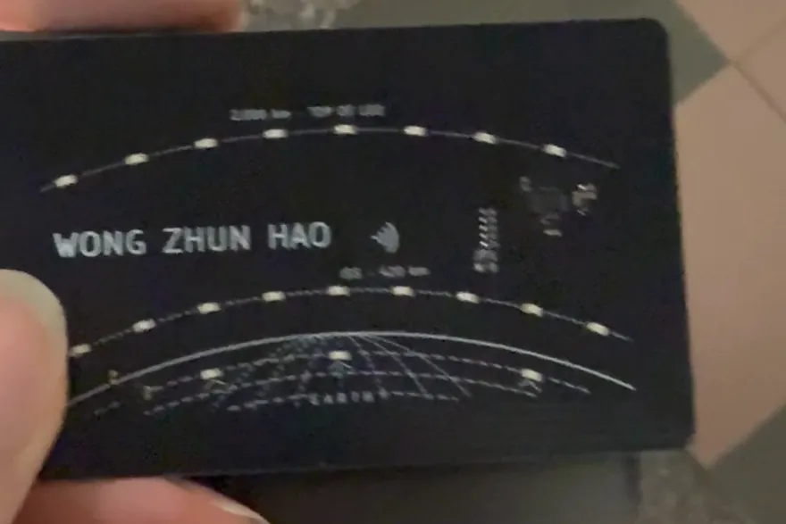
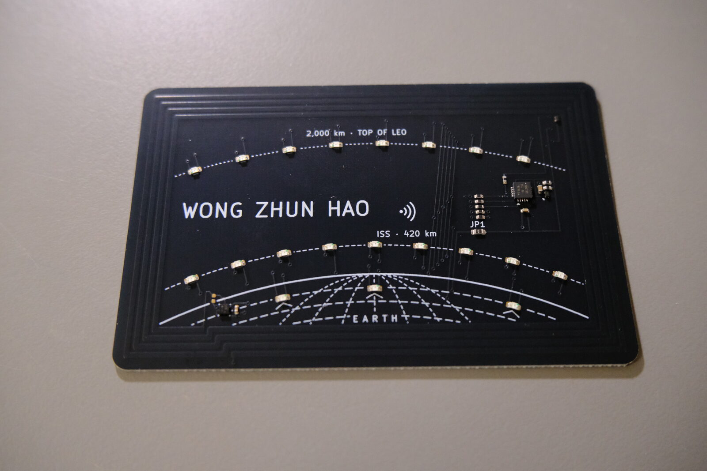
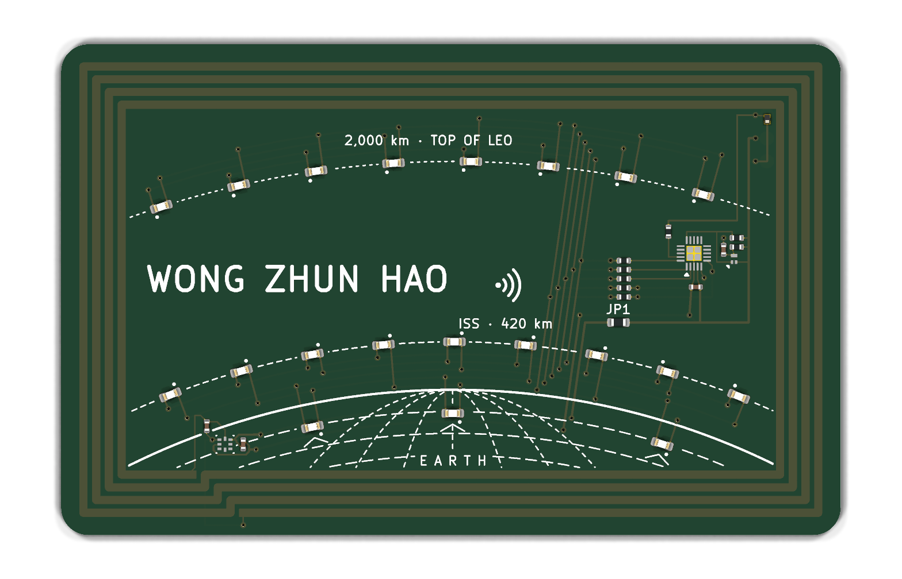
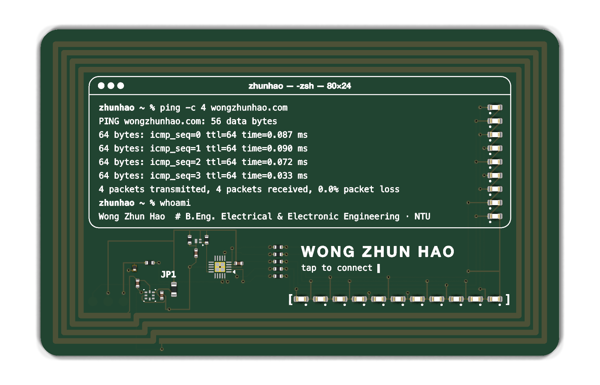
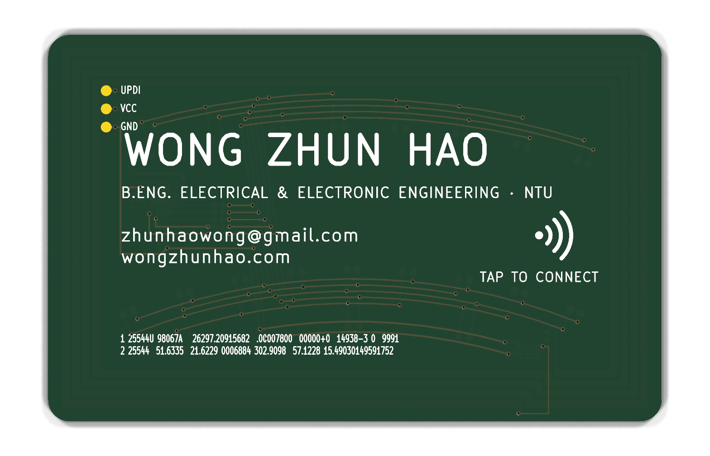
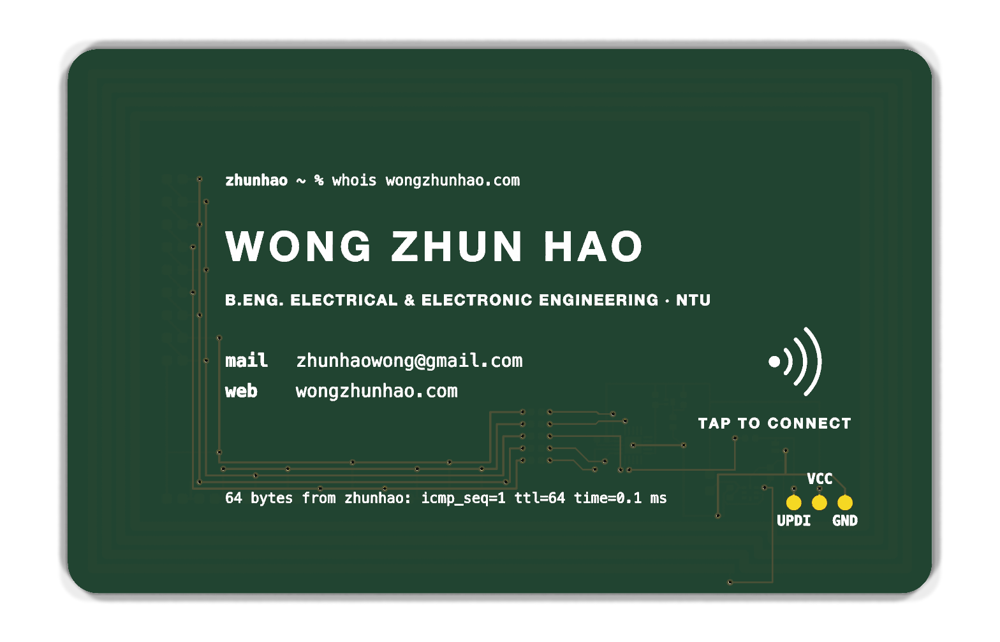
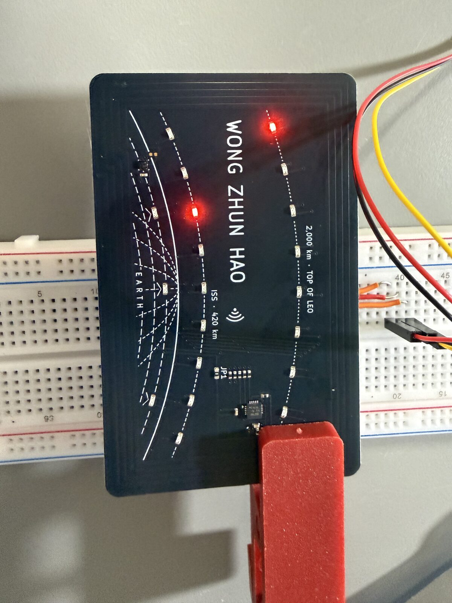
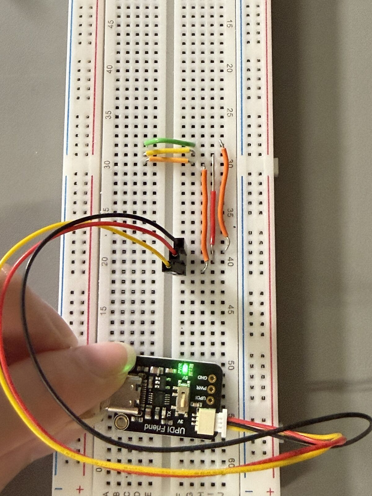

# NFC energy-harvesting business cards

Two battery-free PCB business cards. Tap one on a phone and its NFC field powers an
ATtiny1616 that animates 20 Charlieplexed red LEDs. There's no battery and no button.



The Orbit card on the back of an Android phone, running only on power harvested from the NFC
field: an ISS pass, the ground stations, then the 2,000 km pass.



The Terminal card hasn't been built yet, so these are the KiCad renders of both designs:

| C1 Orbit | B3 Terminal |
| --- | --- |
|  |  |
|  |  |

- **C1 Orbit**: Earth's limb, the ISS orbit (420 km) and the top of LEO (2,000 km) at true
  scale (1 mm ≈ 80 km). LEDs trace an ISS pass, light three ground stations, then run the
  2,000 km pass.
- **B3 Terminal**: a macOS Terminal window running `ping`. Each output line gets a status LED,
  and a progress bar fills along the bottom.

The phone number is left off the committed boards; see [Your own contact details](#your-own-contact-details).

## Inspiration and credit

This project is directly inspired by **Wilson Harper's
[NFC Energy-Harvesting PCB Business Card with an MCU](https://wilsonharper.net/projects/businesscard/)**
([repo](https://github.com/WiHarper/nfc-card)). His write-up showed that an NXP NTAG I2C Plus
can harvest enough power from a phone to run an ATtiny and Charlieplexed LEDs on a card-sized
board. Several decisions here follow his card directly:

- the **soft-start reservoir**: a large capacitor charged through a resistor, then switched
  in by a P-FET under MCU control, so VOUT stays inside the NTAG's 220 nF limit at start-up;
- a perimeter coil with **no ground plane** and LED routing that never closes a loop;
- **UPDI / VCC / GND pads at 0.1" pitch** on the back for a pogo-pin clip, with a TVS diode on
  UPDI, programmed with an Adafruit UPDI Friend;
- thin (≈ 0.8 mm) ENIG boards, assembled by JLCPCB.

Read his write-up first. It explains the core ideas better than this repo does. What this
repo adds is two new card designs on an ATtiny1616 (VQFN-20), scripted KiCad layouts,
interrupt-driven LED scanning with brown-out-aware power tiers, and a bring-up log that
includes iPhone behaviour.

## Hardware

| | |
| --- | --- |
| NFC / harvester | NXP NTAG I2C Plus NT3H2111 (VOUT energy harvesting) |
| MCU | Microchip ATtiny1616-MNR, VQFN-20 3 × 3 mm |
| LEDs | 20 × red 0603, Charlieplexed on 5 GPIOs, 100 Ω per line |
| Antenna | 4-turn perimeter coil, 0.50 mm gaps, tuned with the NTAG's 50 pF |
| Board | ID-1 (85.6 × 54 mm), 0.8 mm FR-4, 2 layers, black mask, ENIG |
| Programming | UPDI pads TP1–TP3 on the back (UPDI / VCC / GND, 2.54 mm pitch) |

The two cards share one circuit, and `scripts/check.sh` checks it: each schematic's netlist
must match `fab/reference/card-netlist.xml`.

**Status (2026-11):** Orbit has been built (JLCPCB order Y8) and brought up. On Android the
full animation runs on harvested power. iOS only powers the field in short polls, so an
iPhone tap gives a single LED blink and opens the URL. See
[docs/bringup](docs/bringup/2026-11-08-orbit-first-cards.md).



## Repository layout

```
hardware/   KiCad 10 projects (orbit/, terminal/), shared symbol + footprint library (lib/),
            and the Python builders that generate each board's placement, routing and silk
firmware/   bare-metal C for the ATtiny1616: shared core in src/, one animation per board in
            boards/, host tests in tests/, programming script in tools/
scripts/    checks (ERC/DRC/parity/netlist/coil loops/thickness), antenna generator, JLC
            DFM clean-up, fab export (single card and two-card panel)
sim/        LTspice decks and coil inductance estimates
docs/       design concepts, NFC tag setup, panel quotes, bring-up log
gallery/    photos of the built Orbit card and renders of both designs
```

## Build and check

You need KiCad 10 (`kicad-cli` and its bundled Python), Python 3, a host C compiler and
avr-gcc 14.3.0 (the version the ISR timing was audited against).

```bash
AVR_CC=/path/to/avr-gcc-14.3.0 ./scripts/check.sh
```

This runs ERC, DRC, schematic parity, board thickness, coil-loop and netlist checks for every
board under `hardware/`, plus the firmware host tests and AVR builds for every animation.

Regenerate a board after editing its builder (run it with KiCad's Python):

```bash
/Applications/KiCad/KiCad.app/Contents/Frameworks/Python.framework/Versions/Current/bin/python3 hardware/orbit/build_orbit.py
```

Export a JLCPCB package (gerbers, BOM, CPL with JLC rotation offsets, renders). It goes to
`fab/<board>-v2/`, which is not committed:

```bash
python3 scripts/export-card.py orbit
```



Flash a card over UPDI (Adafruit UPDI Friend plus a 0.1" pogo clip). See
[firmware/README.md](firmware/README.md):

```bash
firmware/tools/program-card.sh orbit-01
```

The NTAG is written from a phone (NFC Tools or NXP TagWriter). A blank NT3H2111 has to be
formatted first; see [docs/nfc-tag.md](docs/nfc-tag.md).

## Your own contact details

The card backs print a name, title, email and website. To keep a phone number out of the
repo, the committed boards leave it off, and the builders only add it when you pass a
private contact file:

```bash
cp contact.example.json contact.local.json   # gitignored; put your number in it
python3 scripts/export-card.py orbit --contact contact.local.json
```

That rebuilds a private copy under `build/personal/` and exports gerbers from that copy. The
boards under `hardware/` are not touched. To make the cards your own, change the name, email
and site in `hardware/*/build_*.py`.

## License

- Hardware (`hardware/`, `fab/reference/`, `sim/`):
  [CERN-OHL-S-2.0](LICENSES/CERN-OHL-S-2.0.txt)
- Firmware and scripts (`firmware/`, `scripts/`, `docs/design/data/`):
  [GPL-3.0-or-later](LICENSES/GPL-3.0-or-later.txt)

These are the licences of [Wilson Harper's card](https://github.com/WiHarper/nfc-card), which
inspired this one. See [LICENSE.md](LICENSE.md).
